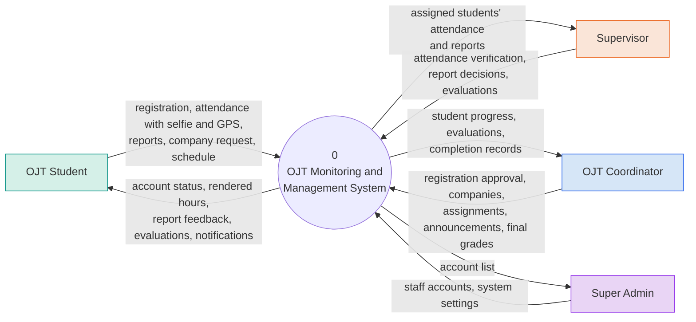

# OJT System Data Flow Diagrams

Renders on GitHub and in any Mermaid viewer (e.g. https://mermaid.live). Rectangles = external entities, circles = processes, double-bar boxes = data stores. Colors: purple = Super Admin, blue = Coordinator, green = Student, orange = Supervisor.

## Level 0 (Context Diagram)

## Level 1

```mermaid
flowchart LR
    student[OJT Student]:::student
    sup[Supervisor]:::sup
    coord[OJT Coordinator]:::coord
    admin[Super Admin]:::admin

    p1(("1.0<br/>Manage Accounts<br/>and Roles"))
    p2(("2.0<br/>Manage Profile<br/>and Placement"))
    p3(("3.0<br/>Record<br/>Attendance"))
    p4(("4.0<br/>Compute<br/>Rendered Hours"))
    p5(("5.0<br/>Manage<br/>Reports"))
    p6(("6.0<br/>Monitor<br/>Progress"))
    p7(("7.0<br/>Evaluate<br/>Performance"))
    p8(("8.0<br/>Send Notifications<br/>and Announcements"))
    p9(("9.0<br/>Finalize<br/>Completion"))

    d1[["D1 Users"]]
    d2[["D2 Students"]]
    d3[["D3 Companies"]]
    d4[["D4 Student Assignments"]]
    d5[["D5 Attendance"]]
    d6[["D6 Internship Progress"]]
    d7[["D7 Reports"]]
    d8[["D8 Evaluations"]]
    d9[["D9 Notifications and Announcements"]]

    %% 1.0 Accounts
    admin -->|staff account details| p1
    student -->|registration and ID cards| p1
    p1 -->|account records| d1
    p1 -->|account list| admin

    %% 2.0 Profile and placement
    student -->|profile, company request, schedule| p2
    coord -->|approvals, companies, assignments| p2
    p2 -->|student profile| d2
    p2 -->|company details| d3
    p2 -->|assignment| d4

    %% 3.0 Attendance
    student -->|time-in/out, selfie, GPS| p3
    d4 -->|assignment and geofence| p3
    sup -->|attendance verification| p3
    p3 -->|attendance record| d5

    %% 4.0 Rendered hours
    d5 -->|verified attendance| p4
    p4 -->|rendered hours| d6

    %% 5.0 Reports
    student -->|report file| p5
    sup -->|report decision| p5
    p5 -->|report record| d7
    p5 -->|report feedback| student

    %% 6.0 Progress
    d6 -->|hours| p6
    d7 -->|report status| p6
    p6 -->|progress overview| coord
    p6 -->|rendered hours| student

    %% 7.0 Evaluation
    sup -->|midterm and final ratings| p7
    p7 -->|evaluation record| d8
    p7 -->|evaluation result| student

    %% 8.0 Notifications
    coord -->|announcement| p8
    p8 -->|notification and announcement| d9
    p8 -->|notifications| student

    %% 9.0 Finalization
    d6 -->|completed hours| p9
    d8 -->|evaluations| p9
    coord -->|final grade, clearance| p9
    p9 -->|completion records| coord

    classDef admin fill:#e9d5f5,stroke:#9333ea
    classDef coord fill:#d6e6f7,stroke:#2563eb
    classDef student fill:#d5f0e8,stroke:#0d9488
    classDef sup fill:#fae5d8,stroke:#ea580c
```

