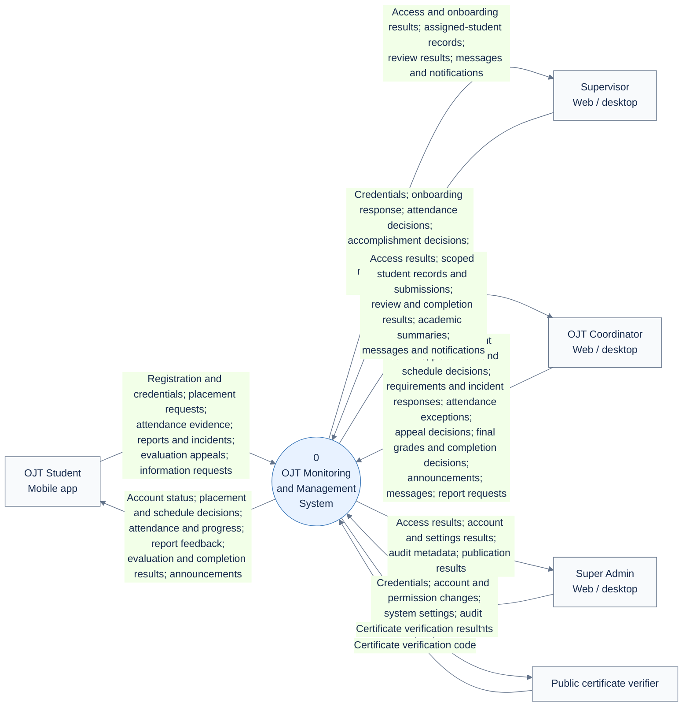
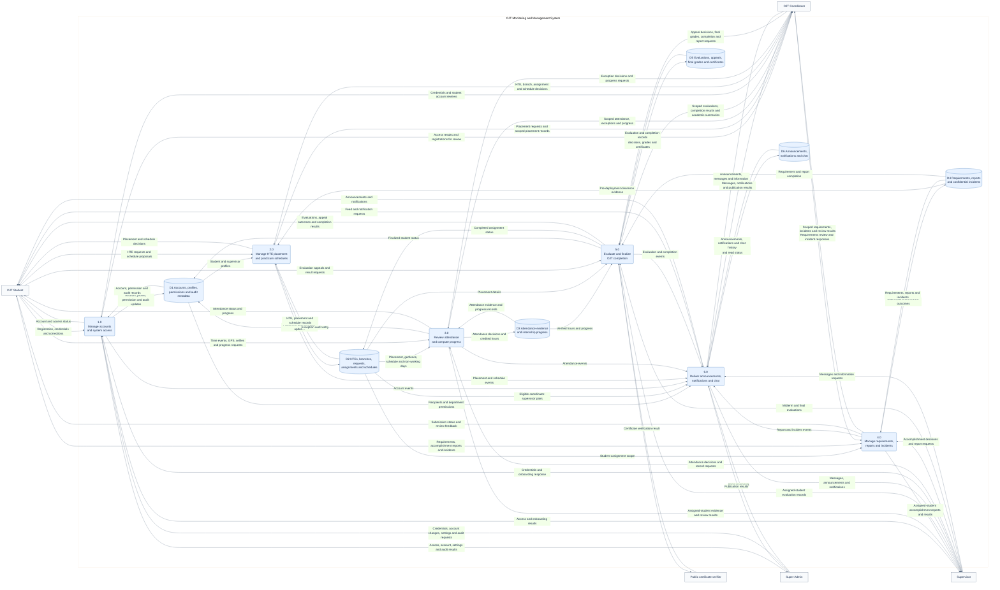
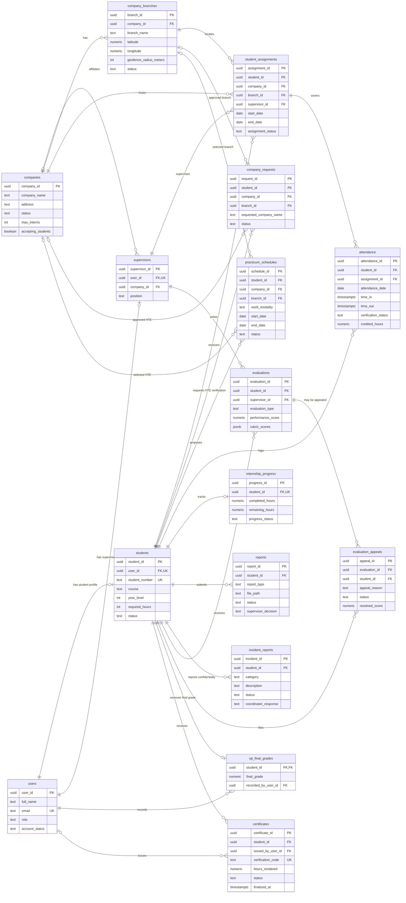
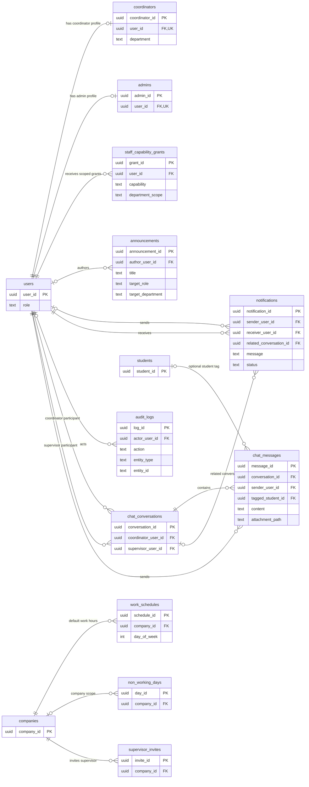

# OJT system diagrams

Colegio de Montalban — fourth-year ICS and IBE students.

Prepared from the repository's AGENTS.md, GLOSSARY.md, ADR 0006, shared database types, schema.sql, and migrations through 20261028000300. These are repository-based documentation views, not a live database audit.

## Reading the diagrams

- **Level 0** means the context diagram: one process, external actors, and information crossing the boundary. Some schools call this the context diagram and call the next diagram Level 0; check your department's naming convention.
- **Level 1** decomposes that process into six numbered processes and six logical data stores. Rounded boxes are processes, rectangles are actors, and cylinders are data stores. Arrow labels describe data, not execution order.
- The system boundary includes mobile/web software, authentication, database, private file storage, and notification delivery. Provider internals are intentionally abstracted.
- **ERD** uses actual table names with selected key attributes. PK = primary key, FK = foreign key, UK = unique key. Crow's-foot ends denote many; a circle denotes optional. The two ERD views together cover the principal application records; they are not a complete physical schema dump.
- Open the .mmd files in a Mermaid-compatible editor to edit or export images.

## Important interpretation notes

- OJT Student, Supervisor, OJT Coordinator, and Super Admin are the four application roles. The public verifier is an unauthenticated actor, not a fifth account role.
- Supervisors see assigned students and review routine attendance and accomplishment reports. Coordinators act within their granted ICS/IBE scope, handle requirements and attendance exceptions, review incidents and appeals, and record final grades.
- Incident content is limited to its reporting student and authorized Coordinators. Its placement in a shared logical store does not grant Supervisors access.
- Only verified attendance contributes credited hours. GPS and selfies are evidence for review; offline attendance sync does not imply approval.
- Chat is between eligible Coordinator–Supervisor pairs, with an optional student tag. Students and Super Admins do not participate.
- One student can have multiple historical assignments, but only one active assignment. Evaluations are unique by student and evaluation type. Attendance is unique by student and date.
- Branch references in assignments, schedules, and HTE requests use composite (company_id, branch_id) foreign keys. Separate edges visualize both dependencies; they do not imply that any company's branch can be selected.
- Optional role profiles are shown from users to students/supervisors/coordinators/admins. These relationships do not imply every user has every profile.
- ERDs omit most reviewer/actor foreign keys, timestamps, evidence paths, and technical tables to keep the views legible. Auth internals, email queue/rate limits, pending account invitations, legacy program_heads/location tables, and schema-version bookkeeping are outside these views. The original SQL remains authoritative.

## Logical store mapping

| Store | Main records |
|---|---|
| D1 | users, students, supervisors, coordinators, admins, staff_capability_grants, audit_logs; account/invitation and authentication records |
| D2 | companies, company_branches, company_requests, student_assignments, practicum_schedules, work_schedules, non_working_days, supervisor_invites |
| D3 | attendance, internship_progress, private attendance evidence |
| D4 | reports, incident_reports, private requirements/report files |
| D5 | evaluations, evaluation_appeals, ojt_final_grades, certificates |
| D6 | announcements, notifications, chat_conversations, chat_messages, private chat attachments |

System configuration is an administrative input/output in process 1.0; no unverified system_settings table is invented. File storage and relational metadata are grouped into logical stores, not modeled as identical physical storage.

## Boundary balancing

The same five actors appear in both DFDs. Level 0 groups the detailed flows shown at Level 1:

| Actor | Level 1 processes |
|---|---|
| OJT Student | 1.0 registration/access; 2.0 placement; 3.0 attendance/progress; 4.0 submissions; 5.0 appeals/results; 6.0 feed |
| Supervisor | 1.0 access/onboarding; 3.0 attendance review; 4.0 accomplishment review; 5.0 evaluations; 6.0 chat/feed |
| OJT Coordinator | 1.0 access/account review; 2.0 placement; 3.0 exceptions/progress; 4.0 requirements/incidents; 5.0 finalization/reports; 6.0 communication |
| Super Admin | 1.0 provisioning/settings/audit metadata; 6.0 announcements |
| Public certificate verifier | 5.0 certificate verification |

Read/query requests and their corresponding records are grouped for readability. No actor writes directly to a data store, and no store transfers data directly to another store.

## DFD Level 0 — Context

## DFD Level 1 — Main Processes

## ERD — Core OJT Records

## ERD — Accounts and Communication

