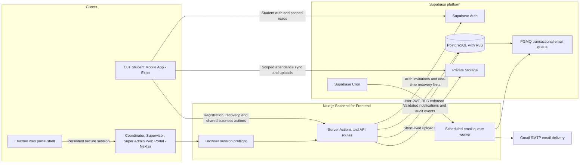

# System Architecture

## Technology stack

- **Web portal:** Next.js App Router, TypeScript, Tailwind CSS
- **Student mobile app:** React Native, Expo, TypeScript
- **Backend and database:** Supabase PostgreSQL, Auth, Row Level Security, private Storage, and Queues
- **Desktop application:** Electron shell for the web portal
- **Observability:** Sentry for Next.js browser, server, and edge errors

The system keeps the existing Next.js, Expo, Supabase, and Electron stack. Expo Go remains the mobile development workflow until a custom native development build is approved.

## Logical architecture

## Trust and data boundaries

1. **The clients are role-specific.** OJT Students use mobile only. Supervisors, OJT Coordinators, and Super Admins use the web portal or desktop wrapper. Database role strings may remain compatible during migration, but the application exposes only those four roles.
2. **Next.js is the business-action boundary.** Mobile registration and shared workflows use authenticated Next.js routes. Supabase Auth remains in the native client; the mobile app may use direct RLS-scoped reads and the established offline attendance synchronization.
3. **Middleware is a session preflight.** It refreshes and checks browser sessions before page rendering. Each Server Action and API route authenticates and authorizes its caller; middleware is not the only security boundary.
4. **User actions preserve the user JWT.** Next.js uses the caller's JWT for application reads and writes so database and Storage RLS remain active. Narrow server-only service-role paths require explicit identity and scope checks. The service key never enters a client bundle.
5. **Super Admin access requires MFA.** The administration page withholds account data until the session reaches AAL2. Account management, audit access, and any other Super Admin service action also require AAL2 on the server. Super Admins manage accounts and system settings; they have no routine access to academic records, student files, attendance, or chat content.
6. **Password recovery uses single-use links.** Requests are rate-limited and return the same response for unknown, inactive, and wrong-role email addresses. Student requests go through the server-side role check and return to `cdm-ojt-monitoring://auth/reset-password`; the app accepts only the exact recovery URI and changes the password there. Web roles use the web callback and password setup page. Legacy OTP reset messages are discarded.
7. **Storage remains private.** Uploads use validated, user-owned paths; server-mediated upload routes validate bytes before business metadata is written. Signed download URLs are short-lived and issued only after checking the caller's access to the record.
8. **Offline attendance retains both clocks.** Mobile device-captured event time is preserved separately from server receipt time. Synced events remain pending until a human verifies their evidence; receipt time does not replace event time or approve attendance.
9. **Email delivery is asynchronous.** PostgreSQL PGMQ stores account-status and Supervisor welcome messages. Supabase Cron invokes the protected Next.js worker, which sends through Gmail SMTP with retries. Password reset links are sent by Supabase Auth.
10. **Telemetry avoids user content.** Sentry captures Next.js errors only when configured. Default PII, request bodies, cookies, query strings, and console breadcrumbs are excluded. Expo Go cannot load Sentry's native SDK; mobile crash reporting requires a future custom development build.

## Operational requirements

- `database/migrations` and `supabase/migrations` are not a reconciled history, and production has a separate applied history. Compare the actual DDL and migration history against a restorable production-schema clone before applying migrations. A revision number alone does not prove parity.
- Add `cdm-ojt-monitoring://auth/reset-password` to the intended Supabase project's Auth redirect allowlist before enabling student recovery in a release build.
- Configure `CRON_SECRET`, SMTP credentials, and Sentry DSNs outside source control. Keep source-map upload credentials in the build environment only.
- Configure Supabase Cron to call `/api/internal/process-transactional-email` every minute using a Vault-held worker URL and authorization secret. See [Email queue operations](../../../docs/operations/email-queue.md).
- The requested production reset is data-only. Preserve schema and migration history, back up the database and Storage object bytes separately, and rehearse both restores in an isolated project before deletion. See [Production data reset gate](../../../docs/operations/production-data-reset.md).
- Review the actual live project's Storage RLS policies, queue extension availability, Auth redirect allowlist, and advisor findings before deployment.
- Keep the deployment light enough for the documented 8 GB RAM developer machines; Supabase services remain hosted or managed externally.
